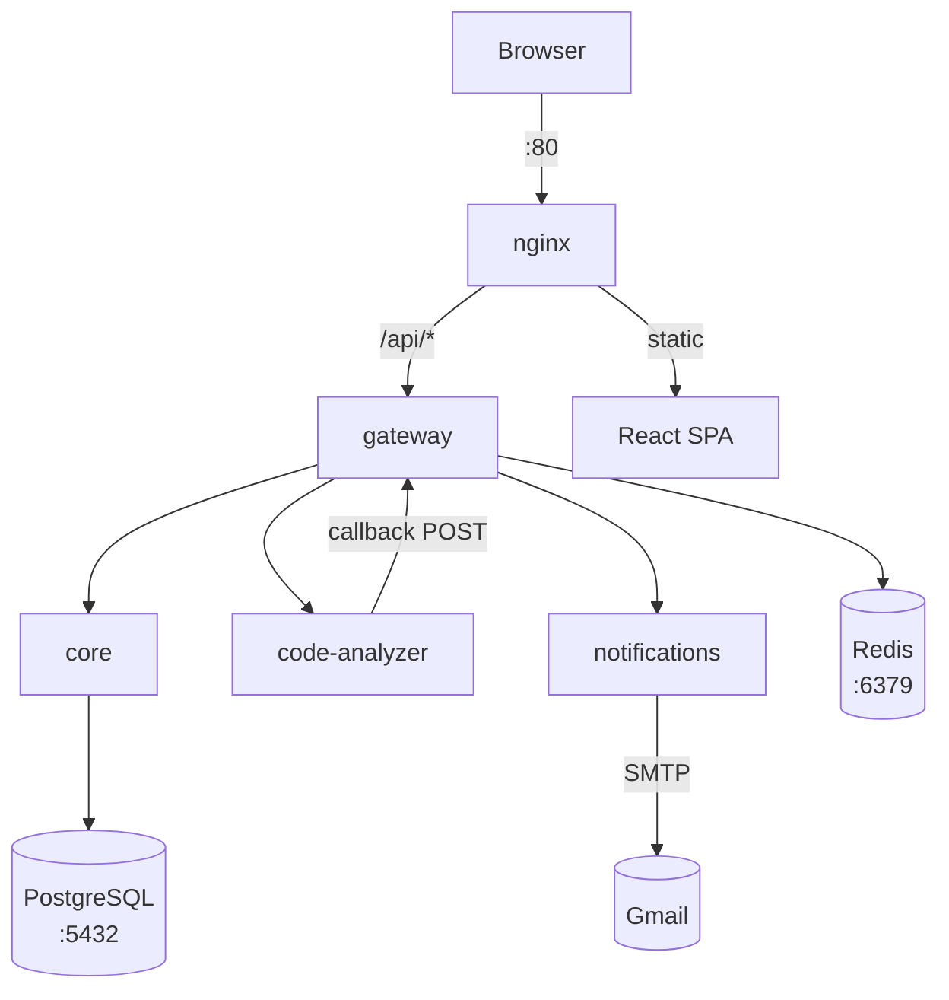
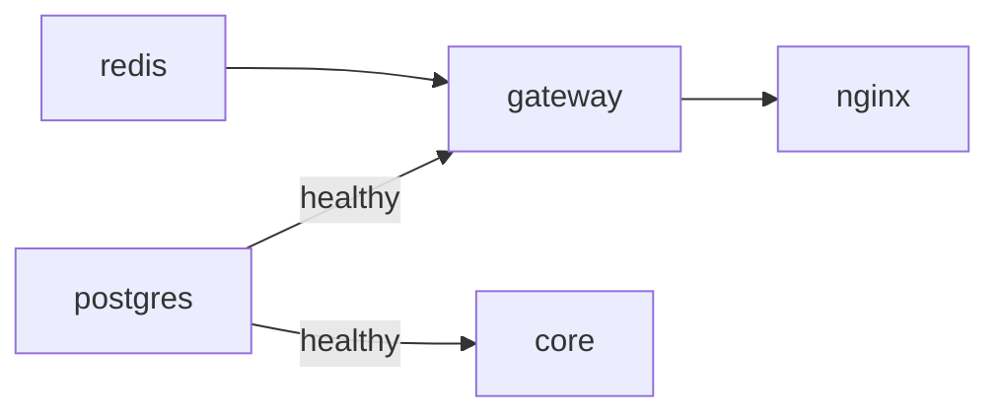
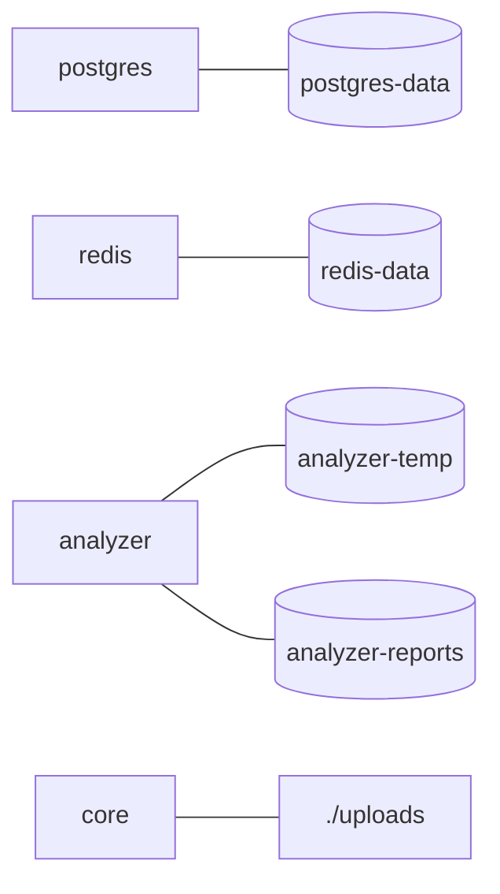

# Committed — Docker Architecture

## Service Network



## Startup Order



## Volumes



## File Structure

```
committed/
├── docker/
│   ├── docker-compose.yml            # all services, volumes, network
│   ├── .env                          # required environment variables
│   ├── nginx/
│   │   ├── Dockerfile                # builds nginx image (copies web/ + docs/)
│   │   ├── nginx.conf                # reverse proxy rules (/api/* → gateway)
│   │   └── scalar.html               # API docs UI
│   └── db/
│       ├── init.sql                  # database initialisation
│       ├── 01_schema.sql             # table definitions
│       ├── 02_seed_data.sql          # seed data
│       ├── 03_cleanup.sql            # cleanup helpers
│       ├── 04_example_queries.sql
│       └── 05_token_version.sql      # JWT token versioning table
│
├── web/                              # → copied into nginx image (React SPA)
│   └── package.json
│
├── docs/
│   └── openapi.yaml                  # → copied into nginx image (/docs)
│
└── services/
    ├── gateway/                      # Java Spring Boot
    │   ├── Dockerfile
    │   ├── pom.xml                   # → copied (Maven build)
    │   └── src/                      # → copied (Java source)
    │
    ├── core/                         # PHP Symfony
    │   ├── Dockerfile
    │   ├── composer.json             # → copied (PHP deps)
    │   ├── composer.lock             # → copied
    │   ├── (project files)           # → copied (full Symfony app)
    │   └── docker/
    │       ├── nginx.conf            # → copied into container
    │       ├── supervisord.conf      # → copied into container
    │       └── php.ini               # → copied into container
    │
    ├── code-analyzer/                # Python Flask
    │   ├── Dockerfile
    │   ├── requirements.txt          # → copied (Python deps)
    │   ├── kilo.jsonc                # → copied (Kilo CLI config)
    │   ├── entrypoint.sh             # → copied (container startup)
    │   ├── .kilo/
    │   │   └── package.json          # → copied (Kilo CLI deps)
    │   └── (project files)           # → copied (full app)
    │
    └── notifications/                # .NET Core
        ├── Dockerfile
        ├── *.csproj                  # → copied (.NET project)
        └── (project files)           # → copied (full app)
```
