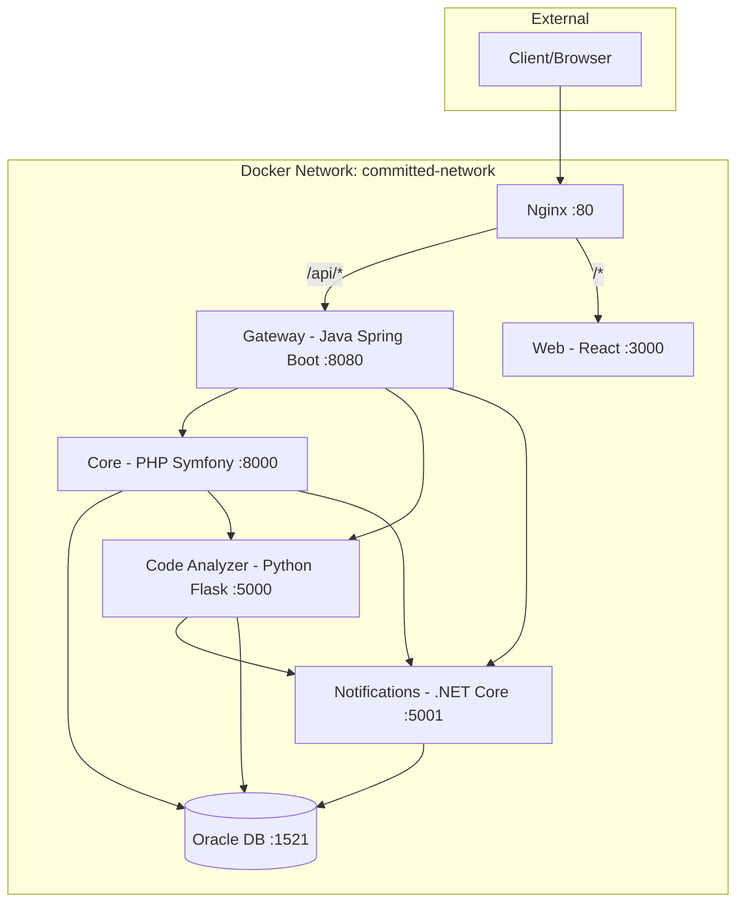
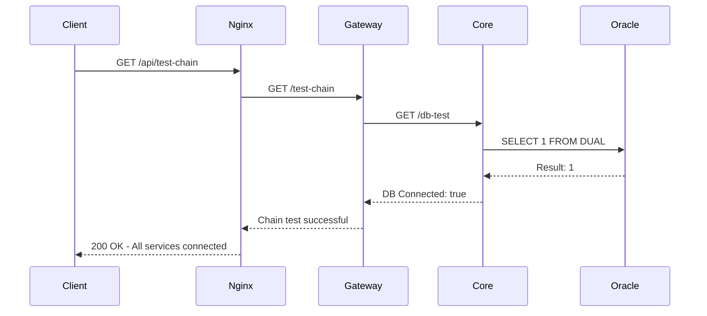

# Committed Project Initialization Plan

## Overview

This plan outlines the steps to initialize the Committed microservices project structure, Docker configuration, and create minimal "hello world" services that demonstrate end-to-end connectivity.

**End Goal**: Be able to `curl` a request to the Gateway service and receive a response after the Gateway connects with Core, and Core connects with the Oracle database.

## Architecture Diagram



## Project Structure

```
commit-ed/
├── README.md
├── .gitignore
├── .env.example
├── .env
│
├── docker/
│   ├── docker compose.yml
│   ├── nginx/
│   │   └── nginx.conf
│   └── db/
│       └── init.sql
│
├── services/
│   ├── gateway/                 # Java Spring Boot - IntelliJ IDEA
│   │   ├── Dockerfile
│   │   ├── README.md
│   │   ├── pom.xml
│   │   └── src/
│   │       └── main/
│   │           ├── java/com/committed/gateway/
│   │           │   ├── GatewayApplication.java
│   │           │   └── controller/
│   │           │       └── HealthController.java
│   │           └── resources/
│   │               └── application.yml
│   │
│   ├── core/                    # PHP Symfony - PhpStorm
│   │   ├── Dockerfile
│   │   ├── README.md
│   │   ├── composer.json
│   │   ├── public/
│   │   │   └── index.php
│   │   ├── config/
│   │   └── src/
│   │       └── Controller/
│   │           └── HealthController.php
│   │
│   ├── code-analyzer/           # Python Flask - VSCode
│   │   ├── Dockerfile
│   │   ├── README.md
│   │   ├── requirements.txt
│   │   ├── app.py
│   │   └── config.py
│   │
│   └── notifications/           # .NET Core - VSCode
│       ├── Dockerfile
│       ├── README.md
│       ├── Notifications.csproj
│       ├── Program.cs
│       └── Controllers/
│           └── HealthController.cs
│
├── web/                         # React + Vite - VSCode
│   ├── Dockerfile
│   ├── nginx.conf
│   ├── README.md
│   ├── package.json
│   ├── vite.config.js
│   ├── index.html
│   └── src/
│       ├── main.jsx
│       └── App.jsx
│
├── docs/
│   ├── SETUP.md
│   ├── ARCHITECTURE.md
│   └── API.md
│
└── plans/
    └── project-initialization-plan.md
```

## Implementation Steps

### Phase 1: Root Project Setup

1. **Create directory structure**
   - Create all folders as shown above
   - Initialize git repository

2. **Create root configuration files**
   - [`.gitignore`](.gitignore) - Ignore IDE files, env files, build artifacts
   - [`.env.example`](.env.example) - Template for environment variables
   - [`.env`](.env) - Actual environment variables (not committed)
   - [`README.md`](README.md) - Project overview and quick start

### Phase 2: Docker Configuration

3. **Create Docker Compose setup**
   - [`docker/docker compose.yml`](docker/docker compose.yml) - All services orchestration
   - [`docker/nginx/nginx.conf`](docker/nginx/nginx.conf) - Reverse proxy configuration
   - [`docker/db/init.sql`](docker/db/init.sql) - Database initialization script

### Phase 3: Service Scaffolds

Each service will have minimal code to demonstrate:
- A `/health` endpoint returning service status
- A `/test-chain` endpoint (on Gateway) that calls Core, which queries the database

4. **Gateway Service (Java Spring Boot)**
   - Minimal Spring Boot application
   - Health endpoint
   - Test endpoint that calls Core service
   - Dockerfile for containerization

5. **Core Service (PHP Symfony)**
   - Minimal Symfony application
   - Health endpoint
   - Database connectivity test endpoint
   - Dockerfile for containerization

6. **Code Analyzer Service (Python Flask)**
   - Minimal Flask application
   - Health endpoint
   - Dockerfile for containerization

7. **Notifications Service (.NET Core)**
   - Minimal ASP.NET Core Web API
   - Health endpoint
   - Dockerfile for containerization

8. **Web Frontend (React + Vite)**
   - Minimal React application
   - Simple UI showing service status
   - Dockerfile for containerization

### Phase 4: Documentation

9. **IDE Setup Guides**
   - PhpStorm guide for Core service
   - IntelliJ IDEA guide for Gateway service
   - VSCode guides for Notifications, Code Analyzer, and Web

10. **Startup Guide**
    - Prerequisites (Docker, IDE installations)
    - Oracle Container Registry login
    - Step-by-step startup instructions
    - End-to-end test commands

## End-to-End Test Flow



## Files to Create

### Root Level
| File | Description |
|------|-------------|
| `.gitignore` | Git ignore patterns |
| `.env.example` | Environment template |
| `.env` | Environment variables |
| `README.md` | Project documentation |

### Docker Configuration
| File | Description |
|------|-------------|
| `docker/docker compose.yml` | Service orchestration |
| `docker/nginx/nginx.conf` | Reverse proxy config |
| `docker/db/init.sql` | Database init script |

### Gateway Service (services/gateway/)
| File | Description |
|------|-------------|
| `Dockerfile` | Container build instructions |
| `README.md` | Service documentation |
| `pom.xml` | Maven dependencies |
| `src/main/java/.../GatewayApplication.java` | Main application |
| `src/main/java/.../controller/HealthController.java` | Health endpoints |
| `src/main/resources/application.yml` | Spring configuration |

### Core Service (services/core/)
| File | Description |
|------|-------------|
| `Dockerfile` | Container build instructions |
| `README.md` | Service documentation |
| `composer.json` | PHP dependencies |
| `public/index.php` | Entry point |
| `src/Controller/HealthController.php` | Health endpoints |
| `config/routes.yaml` | Route definitions |

### Code Analyzer Service (services/code-analyzer/)
| File | Description |
|------|-------------|
| `Dockerfile` | Container build instructions |
| `README.md` | Service documentation |
| `requirements.txt` | Python dependencies |
| `app.py` | Main application |
| `config.py` | Configuration |

### Notifications Service (services/notifications/)
| File | Description |
|------|-------------|
| `Dockerfile` | Container build instructions |
| `README.md` | Service documentation |
| `Notifications.csproj` | .NET project file |
| `Program.cs` | Main application |
| `Controllers/HealthController.cs` | Health endpoints |

### Web Frontend (web/)
| File | Description |
|------|-------------|
| `Dockerfile` | Container build instructions |
| `nginx.conf` | Web server config |
| `README.md` | Service documentation |
| `package.json` | NPM dependencies |
| `vite.config.js` | Vite configuration |
| `index.html` | HTML entry point |
| `src/main.jsx` | React entry point |
| `src/App.jsx` | Main component |

### Documentation (docs/)
| File | Description |
|------|-------------|
| `SETUP.md` | IDE setup guides |
| `ARCHITECTURE.md` | System architecture |
| `API.md` | API documentation |

## Prerequisites

Before starting, ensure you have:

1. **Docker Desktop** (with at least 4GB RAM allocated)
2. **Oracle Container Registry account** - Sign up at https://container-registry.oracle.com
3. **IDEs installed**:
   - PhpStorm (for Core service)
   - IntelliJ IDEA (for Gateway service)
   - VSCode (for Notifications, Code Analyzer, Web)

## Oracle Container Registry Setup

```bash
# Login to Oracle Container Registry
docker login container-registry.oracle.com

# Pull Oracle XE image (this will be done automatically by docker compose)
docker pull container-registry.oracle.com/database/express:21.3.0-xe
```

## Quick Start Commands

```bash
# 1. Clone/navigate to project
cd commit-ed

# 2. Copy environment file
cp .env.example .env

# 3. Edit .env with your settings
nano .env  # or use your preferred editor

# 4. Start all services
cd docker
docker compose up -d

# 5. Wait for Oracle to be healthy (may take 2-3 minutes)
docker compose ps

# 6. Test the chain
curl http://localhost/api/test-chain
```

## Expected Test Response

```json
{
  "status": "success",
  "message": "End-to-end chain test successful",
  "chain": {
    "gateway": "connected",
    "core": "connected",
    "database": "connected"
  },
  "timestamp": "2026-02-03T13:30:00Z"
}
```

## Next Steps After Approval

Once you approve this plan, I will:

1. Switch to **Code mode** to create all the files
2. Create the directory structure
3. Generate all configuration files
4. Create minimal service scaffolds
5. Write the IDE setup documentation

---

**Please review this plan and let me know if you would like any changes before I proceed with implementation.**
